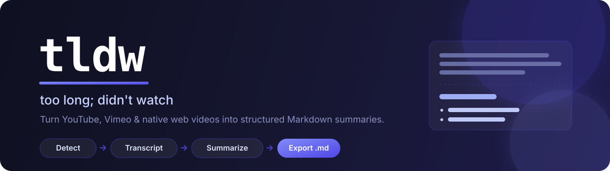
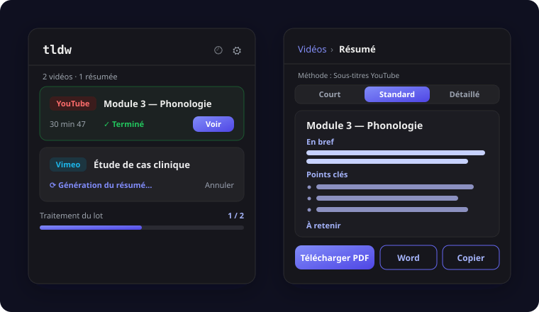

<div align="center">



<br/>

**A Manifest V3 browser extension that turns the videos on a web page into structured summaries — YouTube, Vimeo, Google Drive, embedded course players, any HTML5 `<video>` — even behind a login.**

Runs entirely in your browser, with your own OpenRouter key. No backend. No subscription. No tracking.

<br/>

<table><tr>
<td><a href="https://github.com/adrnbttr/tldw/actions/workflows/ci.yml"></a></td>
<td><a href="./LICENSE"></a></td>
<td><a href="https://developer.chrome.com/docs/extensions/mv3/intro/"></a></td>
<td><a href="https://www.typescriptlang.org/"></a></td>
<td><a href="./CONTRIBUTING.md"></a></td>
</tr></table>

</div>

---

## Table of contents

- [What it does](#what-it-does)
- [Quick start](#quick-start)
- [Supported sites](#supported-sites)
- [What it costs](#what-it-costs)
- [Privacy](#privacy)
- [Troubleshooting](#troubleshooting)
- [How it works](#how-it-works)
- [Development](#development)
- [Documentation](#documentation)
- [License](#license)

## What it does

Open a page with a video, click the tldw icon, press **Summarize**. tldw finds the video, gets its spoken content (captions when they exist, otherwise the audio is transcribed), and writes a **consistently structured** summary: short overview, key points, sections, glossary, takeaways.

- **One summary format, whatever the source.** The model returns structured JSON; the layout is rendered locally from a versioned template, so a summary from captions and one from audio read the same.
- **Works behind a login.** Everything runs in your own browser session — nothing is fetched by a server on your behalf.
- **Long videos.** A 1-hour video works: audio is processed in short windows to keep memory flat, and the progress bar shows download, transcription and summary.
- **Pick the length after the fact.** Short / Standard / Detailed is a display choice on the result — switching is instant and free (no new model call).
- **Export.** PDF or Word, clean-text copy, a local history of past summaries, and multi-video batches combined into one PDF.
- **UI and summary languages** are chosen independently: English, Français, Español, Deutsch.

<div align="center">
  
</div>

## Quick start

1. **Install** — download `tldw-vX.Y.Z.zip` from the [latest release](https://github.com/adrnbttr/tldw/releases/latest), unzip it into a folder you will keep, then in Chrome/Edge open `chrome://extensions` (or `edge://extensions`) → enable **Developer mode** → **Load unpacked** → pick that folder. Details: [`docs/INSTALL.md`](./docs/INSTALL.md). _(From source: `./install.sh`, then load `dist/`.)_
2. **Add your OpenRouter key** — the first-run wizard asks for it ([get one](https://openrouter.ai/keys), add a few dollars of credit). It is also in **Settings**.
3. **Click** — open a page with a video, start playback for a moment, click the tldw icon, **Summarize**. You can close the popup; the job keeps running.

## Supported sites

| Video | Detected as | Text comes from |
|---|---|---|
| **YouTube** (watch page, embed, Shorts, `lite-youtube` and similar click-to-load facades) | `youtube` | Captions. If YouTube blocks them or there are none: **Gemini watches the video URL** (see [costs](#what-it-costs)) |
| **Vimeo** (page, `player.vimeo.com` embed) | `vimeo` | Vimeo text tracks; else audio transcription |
| **Google Drive** (`/file/d/…/view` or `/preview`, including Drive's nested player) | `drive` | Audio transcription |
| **Native HTML5 `<video>`** on any site, including inside open shadow DOM | `native` | Audio transcription |
| **Hosted players in an iframe**: Wistia, Loom, Dailymotion, Brightcove, JW Player, Kaltura, Panopto, Streamable, Twitch | `native` | Audio transcription |

The audio path needs a **DRM-free** stream that the page actually requests (HLS, progressive MP4 / byte ranges, Vimeo `master.json`). Not supported: DRM-encrypted media, DASH-only streams, closed shadow roots, files over **1 GiB**. tldw never tries to bypass DRM. Detection runs in every frame of the page, so cross-origin player iframes are covered; only the URL of an iframe is read, never its content from outside.

## What it costs

You pay OpenRouter directly, per use. Prices are the registry values in [`src/types/settings.ts`](./src/types/settings.ts) (USD per 1M tokens, input/output, verified 2026-10-18). **Everything below is an estimate** for a one-hour talk (~9,000 words ≈ 13k tokens of transcript, a summary of ~1.5k output tokens).

```
cost ≈ (input_tokens × input_price + output_tokens × output_price) / 1,000,000
```

| Path | What is billed (1 h video) | Default model, ≈ cost |
|---|---|---|
| **Captions** (YouTube / Vimeo with captions) | 1 summary call: ~14k in, ~1.5k out | **≈ $0.006** (`gemini-3.1-flash-lite`, $0.25 / $1.50) · ≈ $0.04 with `claude-sonnet-5.5` ($2 / $10) |
| **Audio** (Drive, native, hosted players, Vimeo without captions) | Audio at ~32 tokens/s ≈ 115k in + ~13k out for the transcript, then the summary call above | **≈ $0.05–0.10** — audio tokens may be billed above the text rate; the audio model is `gemini-3.1-flash-lite` |
| **YouTube, no usable captions** | Gemini ingests the video: roughly 300 tokens/s ≈ 1M tokens/h | **≈ $0.25+** for a one-hour video, which also sits near the 1,048,576-token context limit; short videos cost a fraction of this |
| Audio via **OpenAI Whisper** (optional) | OpenAI list price ~$0.006/min | ≈ $0.36 per hour, plus the summary call |

Check live prices and your usage on [openrouter.ai](https://openrouter.ai). The summary model is selectable in Settings; the audio model and the YouTube-video model are fixed to `google/gemini-3.1-flash-lite` (only Gemini models take audio/video input).

## Privacy

- Keys, settings and history live in `chrome.storage.local`, on your machine. A bounded, redacted activity log (`tldw.logs`) is kept there too to help debugging.
- Transcript text, audio and (for YouTube without captions) the video URL go **only to OpenRouter** (or OpenAI if you choose Whisper), with your key. No server of ours exists; no telemetry, no analytics.
- tldw also reads the video hosts themselves (YouTube/Vimeo caption and public oEmbed endpoints, the media files of the page) — the same requests your browser would make.
- The diagnostic report is generated locally; you decide whether to share it.

Full detail: [`docs/PRIVACY.md`](./docs/PRIVACY.md) · [privacy policy page](https://www.adrienbouttier.com/tldw/). Extracting content behind authentication may be governed by a site's terms of use; confirming your usage is permitted is your responsibility.

## Troubleshooting

| Symptom | What to do |
|---|---|
| **“No video detected”** | Play the video for a few seconds, then click **Scan again**. If the page was open before you installed or updated tldw, reload it. |
| **“Play the video for a few seconds…”** (`MEDIA_NEEDS_PLAYBACK`) / “stream could not be retrieved” (`MEDIA_NOT_CAPTURABLE`) | The stream is captured from the page's network traffic: reload the page, press play, wait a couple of seconds, retry. DASH-only and unusual hosts are not supported. |
| **Key / credit / model errors** (`INVALID_API_KEY`, `INSUFFICIENT_CREDITS`, `RATE_LIMITED`, `MODEL_UNAVAILABLE`) | Check the key in **Settings**; add credits at [openrouter.ai/credits](https://openrouter.ai/credits); wait for the rate-limit countdown; pick another model. |
| **Timeout / too large** (`TIMEOUT`, `MEDIA_TOO_LARGE`) | A stalled download fails after 2 minutes of silence; the whole job has a time budget (15 min base, plus the video's duration for transcription). Files over 1 GiB are refused. Retry on a better connection or try a shorter video. |
| **“Interrupted”** (`INTERRUPTED`) or stuck | The browser restarted the extension's background worker; run the summary again. If it persists: **Settings → Diagnostic → Copy the report** and open an issue. |

All error codes, and the diagnostic report: [`docs/TROUBLESHOOTING.md`](./docs/TROUBLESHOOTING.md) (troubleshooting guide).

## How it works

```
content script (every frame) → service worker → offscreen document → OpenRouter
   detects videos              jobs, queue,       download, ffmpeg.wasm,    summary,
                               media capture      transcription chunks      audio transcription
```

Text is obtained in cascade — captions, then audio transcription (YouTube falls back to Gemini watching the URL) — and **every path produces the same `Transcript` object**, so the summarizer does not care where text came from. Full design, messages and job lifecycle: [`docs/ARCHITECTURE.md`](./docs/ARCHITECTURE.md).

## Development

```bash
npm install
npm run dev          # Vite dev server + HMR
npm run build        # typecheck + production build → dist/
npm run build:test   # build and print the path to load in Chrome
npm test             # unit tests (Vitest)
npm run lint         # ESLint + Prettier check
```

Stack: Manifest V3, TypeScript (strict), Preact, Vite + `@crxjs/vite-plugin`, `ffmpeg.wasm` (single-threaded core, in an offscreen document), Vitest, `jsPDF` / `docx` for export.

## Documentation

| Doc | For |
|---|---|
| [`docs/INSTALL.md`](./docs/INSTALL.md) | Installing, updating, uninstalling; first run |
| [`docs/TROUBLESHOOTING.md`](./docs/TROUBLESHOOTING.md) | Troubleshooting guide, error codes, diagnostic report |
| [`docs/PRIVACY.md`](./docs/PRIVACY.md) | What is stored, what is sent, where |
| [`docs/ARCHITECTURE.md`](./docs/ARCHITECTURE.md) | Components, messages, job lifecycle |
| [`docs/TESTING.md`](./docs/TESTING.md) | Validating in a real browser |
| [`docs/RELEASING.md`](./docs/RELEASING.md) | Building, packaging, cutting a release |
| [`docs/ROADMAP.md`](./docs/ROADMAP.md) · [`docs/SPEC.md`](./docs/SPEC.md) | What is next · original functional spec |
| [`CONTRIBUTING.md`](./CONTRIBUTING.md) · [`SECURITY.md`](./SECURITY.md) · [`CODE_OF_CONDUCT.md`](./CODE_OF_CONDUCT.md) | Contributing and reporting |

## License

[MIT](./LICENSE) © Adrien Bouttier
